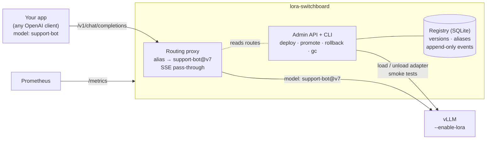

<div align="center">

# lora-switchboard

**Ship LoRA adapters to vLLM like you ship code: versioned, smoke-tested, promoted by alias, rolled back in milliseconds.**

[](https://github.com/xlsarath/lora-switchboard/actions/workflows/ci.yml)
[](pyproject.toml)
[](LICENSE)
[](https://github.com/xlsarath/lora-switchboard/pkgs/container/lora-switchboard)
[](https://github.com/astral-sh/ruff)

</div>

`lora-switchboard` is a small control plane that sits next to a running
[vLLM](https://github.com/vllm-project/vllm) server. It loads adapter versions
at runtime, runs your smoke tests against them **before** they see traffic,
flips a stable alias (`support-bot` → `support-bot@v7`) atomically, and keeps a
full history so you can roll back in one command. Clients talk to an
OpenAI-compatible endpoint and never change config during a rollout.



## 30-second quickstart

No GPU needed: the compose file runs the switchboard next to a tiny **fake
vLLM** that speaks the same API.

```bash
git clone https://github.com/xlsarath/lora-switchboard && cd lora-switchboard
docker compose up -d --build --wait
./examples/demo.sh
```

<details open>
<summary><b>What you will see</b> (real output, fake vLLM on a laptop)</summary>

```text
$ lora-switchboard deploy support-bot --path /adapters/support-bot/a --base-model Qwen/Qwen2.5-7B-Instruct --alias support-bot --smoke smoke-support-bot.yaml
→ loading support-bot@v1 ... ok (404 ms)
→ smoke tests (3) ... pass (5.78 ms)
    ✓ answers order questions      3.10 ms
    ✓ classifies intent as JSON    4.70 ms
    ✓ stays fast                   4.30 ms
→ promote support-bot: (new) → v1 ... ok (flip 1.43 ms)
✔ support-bot now routes to support-bot@v1 (total 418 ms)

$ lora-switchboard deploy support-bot --path /adapters/support-bot/b --alias support-bot --smoke smoke-support-bot.yaml
→ loading support-bot@v2 ... ok (404 ms)
→ smoke tests (3) ... pass (2.40 ms)
→ promote support-bot: v1 → v2 ... ok (flip 1.09 ms)
✔ support-bot now routes to support-bot@v2 (total 411 ms)

$ lora-switchboard deploy support-bot --path /adapters/support-bot/c-broken --alias support-bot --smoke smoke-support-bot.yaml
→ loading support-bot@v3 ... ok (407 ms)
→ smoke tests (3) ... FAIL (3.15 ms)
    ✗ answers order questions      2.40 ms
        - missing 'help'
        - unexpected 'lorem'
        got: 'lorem ipsum dolor sit amet'
    ✗ classifies intent as JSON    2.20 ms
        - output is not JSON (Expecting value)
    ✗ stays fast                   2.30 ms
        - no match for /(?i)hello|help/
→ unloaded support-bot@v3; not promoted
✘ support-bot still routes to support-bot@v2
error: support-bot@v3 failed 3 of 3 smoke tests; it was unloaded and not promoted

$ lora-switchboard rollback support-bot
→ rollback support-bot: v2 → v1 ... ok (flip 3.02 ms)
✔ support-bot now routes to support-bot@v1 (server 3.12 ms, round trip 17 ms)

$ lora-switchboard history --adapter support-bot
time (UTC)      event       version         alias                  duration  detail
11-16 22:07:59  rollback    support-bot@v1  support-bot (from v2)  0.05 ms
11-16 22:07:58  unload      support-bot@v3                         1.17 ms   reason=smoke_fail
11-16 22:07:58  smoke_fail  support-bot@v3                         3.15 ms   3/3 cases failed
11-16 22:07:58  load        support-bot@v3                         407 ms
11-16 22:07:58  register    support-bot@v3                         -
11-16 22:07:57  promote     support-bot@v2  support-bot (from v1)  0.10 ms
...
```

Meanwhile, clients just keep calling `model: "support-bot"`:

```bash
curl -s localhost:8000/v1/chat/completions -H 'content-type: application/json' \
  -d '{"model": "support-bot", "messages": [{"role": "user", "content": "Where is my order?"}]}'
# ... "content": "Happy to help with that! (served by support-bot@v1)"
# response header:  x-switchboard-target: support-bot@v1
```

</details>

Load times here are the fake server's built-in 400 ms delay. On a real GPU a
load usually takes a few seconds, but a rollback to a version that is still
loaded is the same millisecond-scale flip.

---

## Contents

- [Why](#why)
- [Concepts](#concepts)
- [How a rollout works](#how-a-rollout-works)
- [Smoke-test YAML reference](#smoke-test-yaml-reference)
- [CLI reference](#cli-reference)
- [REST API reference](#rest-api-reference)
- [Running against a real vLLM](#running-against-a-real-vllm)
- [Configuration](#configuration)
- [Metrics](#metrics)
- [Limitations](#limitations)
- [Roadmap](#roadmap)
- [Contributing](#contributing)

## Why

vLLM can [load and unload LoRA adapters at runtime][vllm-lora], which makes it
tempting to retrain an adapter and hot-swap it in. In practice that turns into:

- a `curl` to `/v1/load_lora_adapter` from someone's laptop, and every client
  reconfigured to the new adapter name;
- no record of which weights were serving at 14:03 yesterday;
- a broken adapter (bad merge, wrong base model, collapsed outputs) found by
  users instead of by a test;
- a rollback that means "remember the old path, load it again, update clients".

`lora-switchboard` makes adapter rollouts **boring**:

| Without | With lora-switchboard |
| --- | --- |
| Clients hard-code `support-bot-v7` | Clients use `support-bot`; the alias moves |
| Hope the new adapter works | Smoke suite must pass before any traffic |
| Rollback = reload + reconfigure | `lora-switchboard rollback support-bot` (ms) |
| In-flight requests break on swap | Requests keep their version; old one unloads after a drain |
| "Who changed what when?" | Append-only event log per adapter and alias |
| vLLM restart silently drops adapters | Reconcile loop re-loads alias targets |

## Concepts

| Term | Meaning |
| --- | --- |
| **Adapter** | A named LoRA line of work, bound to one base model, e.g. `support-bot` on `Qwen/Qwen2.5-7B-Instruct`. |
| **Version** | One immutable set of weights for an adapter: `support-bot@v7` → `/adapters/support-bot/2026-01-10`. Numbered automatically. The served name in vLLM is always `name@vN`, so a name never changes meaning. |
| **Alias** | A stable name clients use (`support-bot`, `support-bot-canary`, ...) that points to exactly one version of one adapter. Flipping it is atomic. |
| **Event** | An append-only record: `register`, `load`, `load_fail`, `smoke_pass`, `smoke_fail`, `promote`, `rollback`, `unload`, `unload_fail`, `reload`. This is the lineage. |

Version states: `registered` → `ready` (passed smoke) or `smoke_failed` /
`load_failed`; a version an alias was rolled back *from* becomes `rolled_back`
and is skipped by future automatic rollbacks.

## How a rollout works

```mermaid
sequenceDiagram
    participant U as CLI / CI
    participant S as switchboard
    participant V as vLLM
    U->>S: deploy support-bot --path ... --alias support-bot --smoke smoke.yaml
    S->>S: register support-bot@v8 (event: register)
    S->>V: POST /v1/load_lora_adapter {lora_name: "support-bot@v8"}
    V-->>S: 200 (event: load, with timing)
    S->>V: smoke prompts with model = support-bot@v8
    alt all checks pass
        S->>S: CAS alias v7 → v8 in one transaction (event: promote)
        S->>S: swap in-memory route; new requests go to v8
        Note over S,V: v7 stays loaded for rollback (LSB_KEEP_LOADED)<br/>older versions unload after the drain
    else any check fails
        S->>V: POST /v1/unload_lora_adapter (event: smoke_fail, unload)
        S-->>U: exit 2 + per-case report; alias untouched
    end
```

The guarantees, and how they are kept:

- **No request ever hits a missing adapter.** The alias moves only after the
  target is loaded and has passed its smoke tests. A version an alias points to
  can never be unloaded.
- **Zero failed requests during a flip.** Resolving the alias and leasing the
  target happen in one synchronous step; a request keeps that target for its
  whole life (including long SSE streams). The test-suite fires 200 concurrent
  (streaming and non-streaming) requests while flipping the alias 20 times and
  asserts zero failures.
- **Drain before unload.** When a version stops being an alias target, it is
  unloaded only after `LSB_DRAIN_DELAY_S` **and** once its in-flight requests
  finish (bounded by `LSB_DRAIN_TIMEOUT_S`). If a rollback points an alias back
  at it during the drain, the unload is cancelled.
- **Serialized, lost-update-free flips.** Flips for an adapter take a lock and
  write the alias with a compare-and-swap on its revision, so two concurrent
  promotes cannot silently overwrite each other (a stale writer gets `409`).
- **Rollback is never stuck behind a deploy.** Loading and smoke testing a new
  version happen outside the lock; only the millisecond flip takes it.
- **Partial failures leave consistent state.** Load timeouts trigger a
  clean-up unload; versions that are loaded but unreferenced are collected by
  `gc`; the reconcile loop fixes drift between the registry and vLLM (e.g.
  after a vLLM restart wipes runtime-loaded adapters, alias targets are
  re-loaded).

## Smoke-test YAML reference

```yaml
defaults:
  params: {temperature: 0, max_tokens: 128}  # merged into every request
  timeout_s: 30                              # per-request timeout
  max_latency_ms: 3000                       # latency budget unless a test overrides it
concurrency: 4                               # tests run in parallel

tests:
  - name: answers order questions            # unique per suite
    messages:                                # chat completion ...
      - {role: user, content: "Where is my order?"}
    expect:
      contains: ["help"]
      not_contains: ["as an AI"]

  - name: classifies intent as JSON
    prompt: "Classify as JSON: 'I want my money back'"   # ... or text completion
    params: {max_tokens: 64}                 # per-test override
    expect:
      json_schema:
        type: object
        required: [intent]
        properties: {intent: {enum: [refund, shipping, other]}}
      max_latency_ms: 1500
```

| Field | Type | Meaning |
| --- | --- | --- |
| `messages` / `prompt` | list / string | Exactly one per test: chat (`/v1/chat/completions`) or text (`/v1/completions`). |
| `params` | mapping | Extra request fields (`temperature`, `max_tokens`, `stop`, ...). |
| `expect.contains` | string or list | Every string must appear. |
| `expect.not_contains` | string or list | None of these may appear. |
| `expect.regex` | string | Python regex that must match somewhere (`re.search`, DOTALL). |
| `expect.json_schema` | mapping | Output must parse as JSON (a fenced ```` ```json ```` block is accepted) and validate (Draft 2020-12). |
| `expect.max_latency_ms` | number | Wall-clock budget for this request. |
| `expect.case_sensitive` | bool | Default `false`, applies to `contains`, `not_contains` and `regex`. |

Suites are validated up front: bad regexes, invalid schemas, duplicate names
and unknown keys are rejected before anything is loaded. More examples:
[`examples/smoke-support-bot.yaml`](examples/smoke-support-bot.yaml),
[`examples/smoke-sql-helper.yaml`](examples/smoke-sql-helper.yaml).

## CLI reference

The CLI talks to a running switchboard (`--url`, env `LSB_URL`, default
`http://127.0.0.1:8000`; `--token` / `LSB_ADMIN_TOKEN` if the admin API is
protected). Add `--json` before any command for machine-readable output.

| Command | What it does |
| --- | --- |
| `serve` | Run the switchboard (admin API + proxy + metrics). |
| `fake-vllm [--port 8001]` | Run the GPU-free vLLM stand-in. |
| `register ADAPTER --path P [--base-model M]` | Register the next version without loading it. |
| `deploy ADAPTER (--path P \| --version N) --smoke FILE [--alias A]` | Load → smoke → promote. Exit code `2` when smoke tests fail. `--skip-smoke` to opt out explicitly. |
| `promote ALIAS support-bot@v7` | Point an alias at a version (`v7` / `7` work for existing aliases). Loads it if needed. Versions that never passed smoke need `--force`. |
| `rollback ALIAS [--to v5]` | Back to the previous good version; reloads it if it had been unloaded. |
| `unload support-bot@v5 [--no-drain]` | Drain and unload a version no alias uses. |
| `gc ADAPTER [--keep N]` | Unload versions beyond the alias target and newest rollback candidates. |
| `status` | Aliases, targets, in-flight requests, whether each target is really loaded in vLLM. |
| `versions [ADAPTER]` | All versions with state and load status. |
| `history [--adapter A] [--alias A] [--limit N]` | The event log, newest first. |
| `reconcile` | Re-sync the registry with vLLM now (also runs every `LSB_RECONCILE_INTERVAL_S`). |

Typical CI step:

```bash
lora-switchboard deploy support-bot \
  --path "s3-synced/adapters/support-bot/${GIT_SHA}" \
  --alias support-bot --smoke smoke/support-bot.yaml \
  --notes "commit ${GIT_SHA}"
```

## REST API reference

Interactive docs are served at `/docs`. All admin routes accept and return JSON
and, if `LSB_ADMIN_TOKEN` is set, require `Authorization: Bearer <token>`.
Errors share one shape: `{"error": {"code", "message", "details"}}`.

| Method & path | Body / query | Notes |
| --- | --- | --- |
| `POST /admin/deploy` | `{adapter, uri \| version, alias?, smoke \| smoke_yaml \| skip_smoke, base_model?, notes?, sha256?}` | `422 smoke_failed` carries the full per-case report. |
| `POST /admin/adapters/{adapter}/versions` | `{uri, base_model?, version?, sha256?, notes?}` | `201` with the version. |
| `POST /admin/aliases/{alias}/promote` | `{version, adapter?, force?}` | |
| `POST /admin/aliases/{alias}/rollback` | `{to_version?}` | `409` if there is no earlier good version. |
| `POST /admin/adapters/{adapter}/versions/{n}/unload` | `{drain?}` | `409` if an alias routes to it. |
| `POST /admin/adapters/{adapter}/gc` | `{keep?}` | |
| `POST /admin/reconcile` | | |
| `GET /admin/status` · `/admin/aliases` · `/admin/adapters` · `/admin/versions?adapter=` · `/admin/history?adapter=&alias=&limit=` | | |
| `GET /v1/models` | | vLLM's list plus one entry per alias (`root` = current target). |
| `POST /v1/chat/completions` · `/v1/completions` · other `POST /v1/*` | OpenAI request | `model` alias rewritten; response streamed back as-is with `x-switchboard-target`. vLLM's load/unload endpoints are **not** exposed through the proxy. |
| `GET /healthz` · `/readyz` · `/metrics` | | `readyz` is `503` while vLLM is unreachable. |

Names that are not aliases (the base model, or a pinned `support-bot@v5`) are
forwarded unchanged, so A/B tests and debugging against a specific version work
through the same endpoint.

## Running against a real vLLM

Start vLLM with LoRA enabled and runtime updates allowed:

```bash
VLLM_ALLOW_RUNTIME_LORA_UPDATING=True \
vllm serve Qwen/Qwen2.5-7B-Instruct \
  --enable-lora \
  --max-loras 4 \
  --max-lora-rank 64 \
  --port 8001
```

- `--max-loras`: adapters resident on the GPU at the same time. Keep it at
  least `LSB_KEEP_LOADED` × number of adapters, plus one for a deploy in progress.
- `--max-lora-rank`: must be at least the largest rank you will deploy.
- `--max-cpu-loras` (optional): size of vLLM's CPU-side adapter cache.

Then point the switchboard at it:

```bash
LSB_VLLM_URL=http://127.0.0.1:8001 lora-switchboard serve --host 0.0.0.0 --port 8000
lora-switchboard deploy support-bot --path /adapters/support-bot/v1 \
  --base-model Qwen/Qwen2.5-7B-Instruct --alias support-bot --smoke smoke.yaml
```

`--path` is passed verbatim as vLLM's `lora_path`, so it must be readable **by
the vLLM process** (a local directory with `adapter_config.json` and weights,
or whatever your vLLM version accepts). In docker compose, uncomment the `vllm`
service in [`docker-compose.yml`](docker-compose.yml), mount your adapters at
`/adapters`, and set `LSB_VLLM_URL=http://vllm:8001`.

If vLLM runs with `--api-key`, set `LSB_VLLM_API_KEY` for the switchboard's own
calls. Proxied client requests forward the **client's** `Authorization` header;
the switchboard never lends its key to an unauthenticated client.

**vLLM API this project relies on** (checked against the vLLM docs and source
in November 2026):

| Endpoint | Used for | Notes |
| --- | --- | --- |
| `POST /v1/load_lora_adapter` `{"lora_name", "lora_path"}` | deploy, reload | `400 ... has already been loaded` is treated as success (served names are immutable). |
| `POST /v1/unload_lora_adapter` `{"lora_name"}` | unload, gc | `404 ... cannot be found` is treated as success. |
| `GET /v1/models` | status, reconcile | Adapters appear with `root` = path and `parent` = base model. |
| `POST /v1/chat/completions`, `/v1/completions` | smoke tests, proxy | `model` = served adapter name. |

> [!WARNING]
> **Version caveats.**
> - Runtime LoRA updating must be enabled with `VLLM_ALLOW_RUNTIME_LORA_UPDATING=True`.
>   The vLLM docs warn that it carries security risks and should only be used in
>   isolated, trusted environments. Never expose vLLM's own port publicly: expose
>   the switchboard's proxy, which blocks the load/unload endpoints, and protect the
>   admin API with `LSB_ADMIN_TOKEN`.
> - Endpoint names, status codes and error messages above match vLLM's `main`
>   branch as of November 2026. Error bodies have changed shape across releases
>   (`{"error": {"message": ...}}` vs. a top-level `message`); the client accepts both. Newer releases add `load_inplace`, which
>   this project deliberately does not use.
> - Runtime-loaded adapters live in memory only. A vLLM restart drops them; the
>   reconcile loop (every `LSB_RECONCILE_INTERVAL_S`) re-loads alias targets.
> - Served names contain `@` (`support-bot@v7`). vLLM stores `lora_name` as a plain
>   string and we know of no restriction on it, but this has only been exercised
>   against the fake server here. If a gateway in front of vLLM restricts model
>   names, check it.
> - If several vLLM processes or replicas sit behind one URL (a load balancer, or
>   multiple API-server processes), a load request may reach only one of them.
>   Point the switchboard at a single instance (see [Limitations](#limitations)).

## Configuration

All settings are environment variables with the `LSB_` prefix.

| Variable | Default | Meaning |
| --- | --- | --- |
| `LSB_VLLM_URL` | `http://127.0.0.1:8001` | vLLM base URL (a trailing `/v1` is stripped). |
| `LSB_VLLM_API_KEY` | | Bearer token for vLLM admin and smoke calls. |
| `LSB_DB_PATH` | `switchboard.db` (`/data/switchboard.db` in Docker) | SQLite registry file. |
| `LSB_ADMIN_TOKEN` | | If set, `/admin/*` requires `Authorization: Bearer <token>`. |
| `LSB_LOAD_TIMEOUT_S` | `120` | Max time for one adapter load. |
| `LSB_UNLOAD_TIMEOUT_S` | `30` | Max time for one unload. |
| `LSB_REQUEST_TIMEOUT_S` | `600` | Upstream timeout for proxied requests. |
| `LSB_DRAIN_DELAY_S` | `10` | Minimum wait before unloading a version that just lost its alias. |
| `LSB_DRAIN_TIMEOUT_S` | `300` | Max extra wait for its in-flight requests to finish. |
| `LSB_KEEP_LOADED` | `2` | Versions per adapter kept loaded (alias targets + newest rollback candidates). |
| `LSB_AUTO_GC` | `true` | Run `gc` after each promote/rollback. |
| `LSB_RECONCILE_INTERVAL_S` | `30` | Registry ↔ vLLM reconcile period (`0` disables). |
| `LSB_LOG_LEVEL` | `INFO` | |
| `LSB_LOG_JSON` | `false` | One JSON object per log line. |

Logs carry context (`alias`, `target`, `outcome`, `load_ms`, `flip_ms`, ...)
and never include prompts or completions at INFO or above.

## Metrics

`GET /metrics` (Prometheus text format):

| Metric | Labels |
| --- | --- |
| `lsb_proxy_requests_total` | `alias`, `target`, `status` |
| `lsb_proxy_request_seconds` (histogram) | `alias` |
| `lsb_proxy_inflight_requests` | `target` |
| `lsb_rollout_events_total` | `adapter`, `event` |
| `lsb_smoke_duration_seconds` (histogram) | `adapter`, `outcome` |
| `lsb_adapter_load_seconds` (histogram) | `adapter`, `outcome` |
| `lsb_alias_flip_seconds` (histogram) | `alias`, `kind` |
| `lsb_alias_version` | `alias`, `adapter` |

A useful alert: `increase(lsb_rollout_events_total{event="smoke_fail"}[1h]) > 0`.

## Limitations

- **One switchboard, one vLLM endpoint.** Routing state lives in one process
  (backed by SQLite). Running several switchboard replicas against the same
  database is not supported yet: flips are lost-update safe, but other
  replicas would not see a new route until restart. Several vLLM replicas need
  each adapter loaded on each replica, which is on the roadmap.
- **The smoke suite is a gate, not an eval.** It catches broken adapters
  (wrong base, collapsed output, broken formatting, latency regressions); it
  does not measure quality. Run your offline evals before `deploy`.
- **No canary/percentage routing yet.** An alias points to exactly one version.
  Use a second alias (`support-bot-canary`) for manual canaries.
- **Paths are not fetched or verified.** `--path` is handed to vLLM as-is; the
  optional `sha256` is recorded for lineage but not checked.
- **SQLite only.** Fine for a control plane's write volume; Postgres support
  is on the roadmap.

## Roadmap

- [ ] Multiple vLLM replicas per pool (load/unload fan-out, per-replica status)
- [ ] Weighted canaries: `support-bot` → 95% v7 / 5% v8, with auto-promote on healthy metrics
- [ ] Shadow traffic to a candidate version before promotion
- [ ] Postgres registry and multi-replica switchboard (route change notifications)
- [ ] Adapter fetch + checksum verification (S3, GCS, Hugging Face Hub)
- [ ] Smoke checks: semantic similarity, LLM-as-judge hook, `contains_any`
- [ ] SGLang and other OpenAI-compatible servers with dynamic LoRA
- [ ] Helm chart

## Contributing

Issues and pull requests are welcome. The whole test-suite runs in about ten
seconds with no GPU:

```bash
pip install -e ".[dev]"
pytest && ruff check .
```

See [CONTRIBUTING.md](CONTRIBUTING.md) for the layout and ground rules, and
[GOOD_FIRST_ISSUES.md](GOOD_FIRST_ISSUES.md) for starter tasks.

## License

[MIT](LICENSE) © 2026 Sarath Makkena

[vllm-lora]: https://docs.vllm.ai/en/latest/features/lora.html
